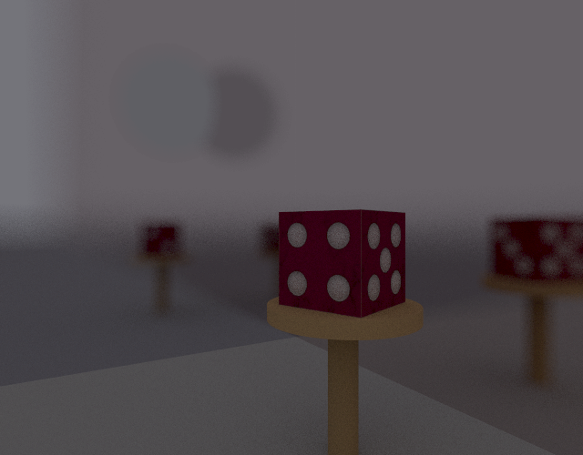
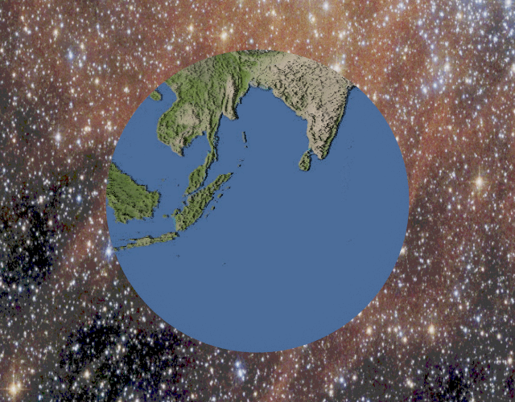
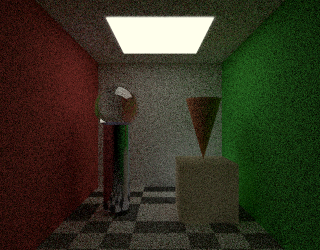
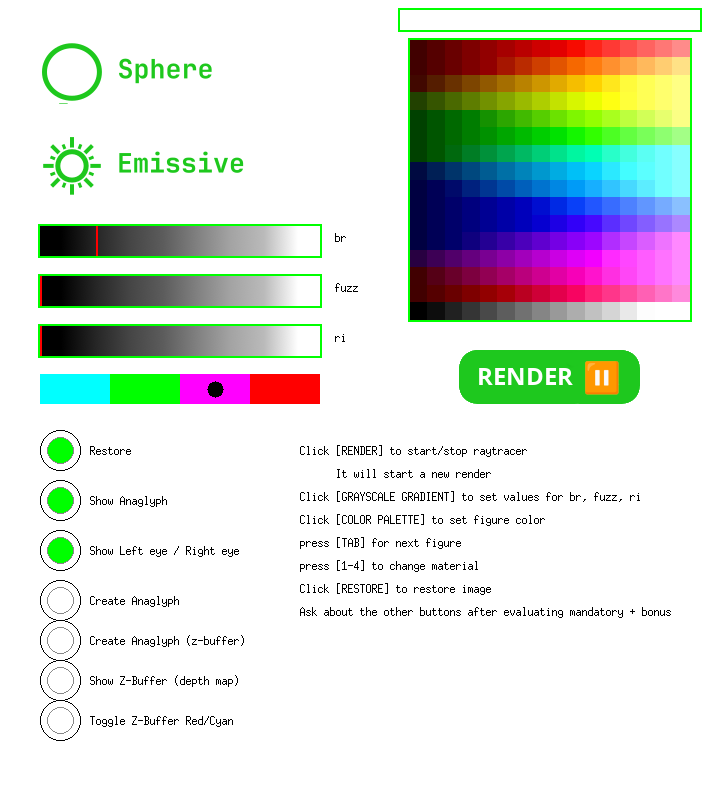
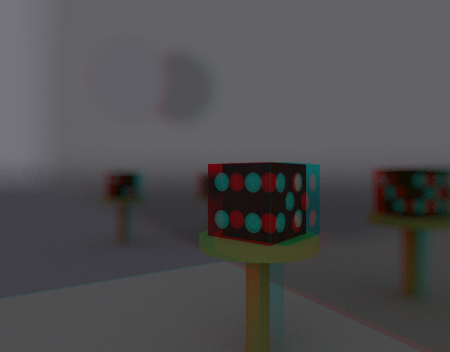
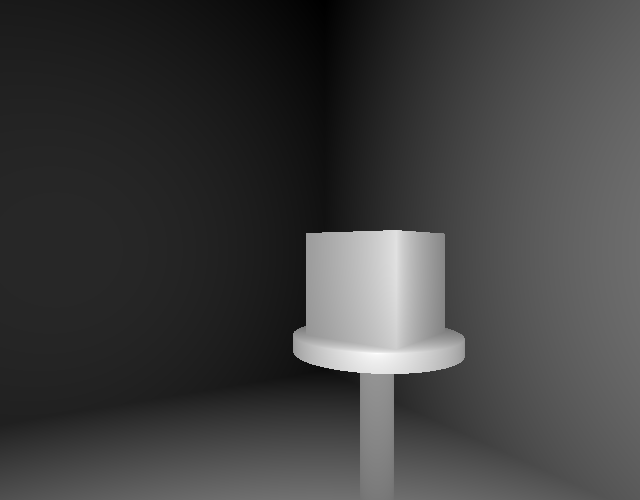

# miniRT

A path tracer written in C with [MiniLibX](https://github.com/42Paris/minilibx-linux), made at 42 Lisboa. It reads a `.rt` scene file and slowly turns a black window into a picture with soft light, reflections, glass, textures and bump maps. On top of that it can do red/cyan anaglyph 3D and depth maps, all driven from a separate menu window.



## What it does

- Path tracing with many rays per pixel - soft shadows and color bleeding come for free
- Shapes - spheres, planes, cylinders, cones, disks and quads
- Materials - matte (lambertian), metal (with fuzz), glass (with refraction index) and emissive (light sources)
- Textures - solid color, checkered, image textures and bump maps (`.xpm`)
- Anaglyph 3D - renders a left and a right eye and merges them (Dubois method), plus a depth-aware version
- Z-buffer view - grayscale depth map of the scene
- Progressive render - keeps adding passes so the noise slowly goes away
- A menu window to change figures, materials, colors and quality without editing the scene file

## Build

Linux only. You need `clang`, `make` and the X11 dev libs (`libX11`, `libXext`) plus `zlib`.

```sh
git clone <this repo>
cd miniRT
make
```

## Run it

```sh
./miniRT scenes/die_with_bumps.rt
```

That one's my favourite. Some others worth a look:

```sh
./miniRT scenes/earth_bump_map.rt      # bump mapped earth floating in space
./miniRT scenes/cornell_box_show.rt    # the classic cornell box, glass ball, cone and all
./miniRT scenes/basic_shapes.rt        # every shape at once
./miniRT scenes/eclipse.rt
```

Two windows pop up on top of each other - the render window (yes, it's called "Not a miniRT") and the menu. Drag the render window aside, then hit RENDER in the menu.

| | |
|---|---|
|  |  |

## The menu window



Everything in the menu works on the currently selected figure, shown at the top left together with its material.

- RENDER - starts the render loop, click again to stop it. It keeps re-rendering until you stop it, so changes you make in the menu show up on the next pass
- Color palette (top right) - click a color to paint the selected figure
- `br` / `fuzz` / `ri` bars - click along the bar to set brightness, metal fuzz and refraction index
- Quality bar - how many rays per pixel
  - cyan - 2 rays, super fast and super noisy, good for moving stuff around
  - green - 20 rays, the default
  - magenta - 60 rays
  - red - 800 rays, go make a coffee

The round buttons at the bottom only work while the render is stopped:

- Restore - back to the last normal render
- Show Anaglyph - show the last anaglyph again
- Show Left eye / Right eye - flip between the two eye images
- Create Anaglyph - renders both eyes and merges them into a red/cyan image (grab your 3D glasses)
- Create Anaglyph (z-buffer) - same idea, but the eye shift follows the depth of each pixel
- Show Z-Buffer (depth map) - grayscale depth, closer is brighter
- Toggle Z-Buffer Red/Cyan - depth map seen from each eye

| anaglyph | z-buffer |
|---|---|
|  |  |

## Keybindings

These work in both windows.

| key | what it does |
|---|---|
| `Esc` | quit |
| `Tab` | select the next figure (loops around) |
| `1` - `4` | set the material of the selected figure - 1 matte, 2 metal, 3 glass, 4 light |
| `h` | turn on progressive render - each extra press adds 20 more passes (max 500) |

Progressive render is keyboard only, there's no button for it. The terminal shows the pass count while it runs.

## Scene files

A scene is a plain text file with one element per line. `A` (ambient), `C` (camera) and at least one light source are required, then add as many objects as you want - `sp`, `pl`, `cy`, `co`, `ds` and `qu`.

```
A   0.3          255,255,255
C   1,1.4,4     0,1.4,0    60
cy  0.7,0.4,1.4  0,1,0  0.2  1.0  120,80,40  1  0.0  1.0  1  0.0  0,0,0  -  -
```

After the color, every object takes the same tail - material, fuzz, refraction index, texture type, scale, checkered color, texture image and bump map image (`-` when unused). The full column layout for each element is in [scenes/instructions.rt](scenes/instructions.rt), and the other files in `scenes/` are good examples to copy from.

## Authors

- [Carlos-o-Grande](https://github.com/Carlos-o-Grande) (cjoao-de)
- [jcameira](https://github.com/jcameira)

This is my own copy, the original lives at [jcameira/MiniRT-42Lisbon](https://github.com/jcameira/MiniRT-42Lisbon/tree/eval) (`eval` branch).

## Resources

- [Advanced Anaglyph Rendering Algorithm (Stanford EE267)](https://web.stanford.edu/class/ee267/Spring2016/report_siu_ikoma.pdf) - a huge help for the anaglyph part
- [Writing a raytracer in Rust](https://bheisler.github.io/post/writing-raytracer-in-rust-part-1/)
- [Accelerated ray tracing in CUDA](https://developer.nvidia.com/blog/accelerated-ray-tracing-cuda)
- [Ray tracing illustrated (UNF)](https://digitalcommons.unf.edu/cgi/viewcontent.cgi?article=1100&context=ojii_volumes)
- [Cal Poly ray tracer project](https://users.csc.calpoly.edu/~zwood/teaching/csc471/final09/nkowshik_webpage/)
- [BSP trees for ray tracing](https://www.sci.utah.edu/~thiago/papers/BSP_RT08.pdf)
